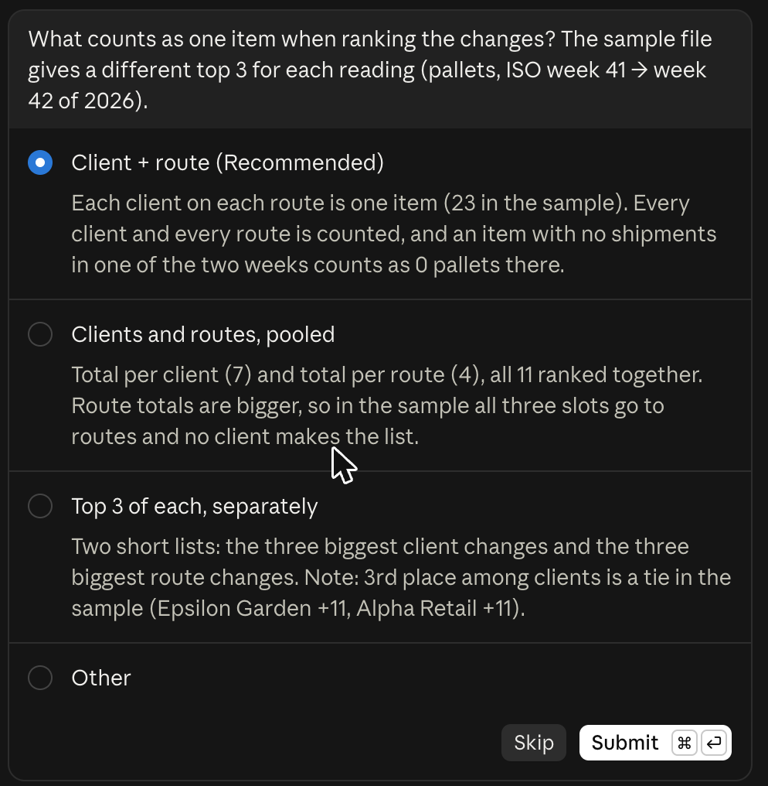

# Builder, step 12: What an agent is

In [step 11](../11-claude-code-on-the-web/), Claude Code wrote a small script, ran it and asked before it went on. That
has a name. It was an agent: a goal, tools, a loop and a stop rule.

Today you learn the four parts, and you write one page that gives an agent all four. We call that page an agent brief.

| | |
|---|---|
| Time | about 15 minutes |
| You need | nothing new. To try the brief: Claude Code, as in [step 11](../11-claude-code-on-the-web/) |
| Tested | the filled-in brief, in Claude Code (Plan mode first), 23 Oct 2026 |
| Download | [agent-brief-template.txt](agent-brief-template.txt), [agent-brief-example-step11.txt](agent-brief-example-step11.txt), [shipments-export-sample.csv](shipments-export-sample.csv) and [the carousel as a PDF](builder-step12-what-an-agent-is-carousel.pdf) (8 slides) |

## The four parts

| Part | The question it answers | Weak | Strong |
|---|---|---|---|
| Goal | What must be true at the end? | "Look at the export" | "A script that prints the three biggest changes, and a README with the rule" |
| Tools | What may it use? | "Whatever you need" | "The sample file and Python, standard library only" |
| Loop | How does it check its own work? | (nothing) | "Run it, compare with a count of your own, find out why if they differ" |
| Stop rule | When does it stop, or stop and ask you? | "Make it better" | "Done when it ran once on the sample file and showed me the output" |

Anthropic says it in one line. Agents are "typically just LLMs using tools based on environmental feedback in a loop"
([Building effective agents](https://www.anthropic.com/engineering/building-effective-agents)). The same page says
agents "can then pause for human feedback at checkpoints or when encountering blockers". That pause is the stop rule.

The brief adds a fifth line: **Never**. What the agent may never do, whatever the goal. For example: never change the
main version, never delete a file, never send anything.

## Chat answer, workflow or agent

| | Chat answer | Workflow | Agent |
|---|---|---|---|
| What it does | Answers once | Follows steps that you fixed in advance | Decides its own next step toward a goal |
| Tools | Sometimes, inside one answer | The ones in each step | The ones you allow |
| Loop | No. You are the loop | Only where you built one | Yes: act, look at the result, adjust |
| When it stops | After one answer | At the last step | When the stop rule says so |

Anthropic draws the same line. Workflows follow "predefined code paths". Agents "dynamically direct their own
processes and tool usage". Not every job needs an agent. A fixed job with fixed steps is often better as a workflow.

## Step 11 was an agent

| Part | What happened in step 11 |
|---|---|
| Goal | The script `changes.py` that prints the three biggest changes, and a README with the rule |
| Tools | The sample export, Python and its own branch |
| Loop | It wrote the script, ran it on the sample file, and tested two edge cases on its own |
| Stop rule | Plan mode: it showed its plan and waited. When it did not know what counts as one item, it stopped and asked |



## Write your own brief

1. Download [agent-brief-template.txt](agent-brief-template.txt).
2. Pick one job you do every week. Small, with a result you can check.
3. Fill in the five parts. Write the goal as a result, not as steps.
4. Write the **Done when** line as a check that anyone can do. "It looks good" is not a check.
5. Write down the moments where it must ask you and not guess.
6. Read the **Never** line again. If the job touches money, client data or email, start with "never send" and
   "never delete".

Paste the brief into Claude Code in **Plan** mode, as in step 11. Read the plan before you accept it.

## Our test: the step 11 job as a brief

[agent-brief-example-step11.txt](agent-brief-example-step11.txt) is the step 11 task, written as a brief with all five
parts. On 23 Oct 2026 we gave it to Claude Code in the terminal, in Plan mode, in a test folder with only the sample export.

1. **The plan came first.** No file changed. The plan had the rule, the two files it would make, and the result it
   expected from a count of its own: BE-BE +35, NL-BE +24, BE-FR -23.
2. **It stopped and asked.** One rule was not in the brief: do BE-NL and NL-BE count as one route or as two? It asked,
   and it did not guess. We answered: two separate routes.
3. **The loop.** After we approved the plan, it wrote `changes.py` and a README, ran the script once, and compared the
   output with its own count.
4. **It stopped when done.** The output:

```text
Pallet changes: 2026-W41 -> 2026-W42
1. route  BE-BE                        25 ->   60  (+35)
2. route  NL-BE                        77 ->  101  (+24)
3. route  BE-FR                        71 ->   48  (-23)
```

The same three changes as the separate count in
[step 11's expected-output.md](../11-claude-code-on-the-web/expected-output.md). The sample file did not change.

## Good to know

- An agent with a vague goal does more than you asked. The goal is the first line of control.
- Fewer tools means fewer surprises. Allow only what the job needs.
- A brief is not a guarantee. Claude reads it as instructions, not as a lock. Plan mode, its own branch and your
  review are what stop a bad change. Later steps add hard limits.
- Never put real client data in a test folder. The sample export is made up.

## Time win and solution win

- **Time win:** fewer rounds of "that is not what I meant". The rule is in the brief before the agent starts.
- **Solution win:** one page you can reuse for every job, and that a colleague can read.

## Common mistakes

| Mistake | Fix |
|---|---|
| The goal is a list of steps | Write the result that must be true at the end. The agent picks the steps |
| No "Done when" line | Add a check anyone can do, such as "the output matches expected-output.md" |
| "Ask me if unsure" | Name the moments: an unclear rule, a missing file, anything that costs money |
| No Never line | Start with: never change main, never delete, never send |
| You accept the plan without reading it | Read the rule in the plan. Click Revise if it is not what you meant |

## Next

Step 13 (Sunday): Claude Code on your own laptop, in one line.
