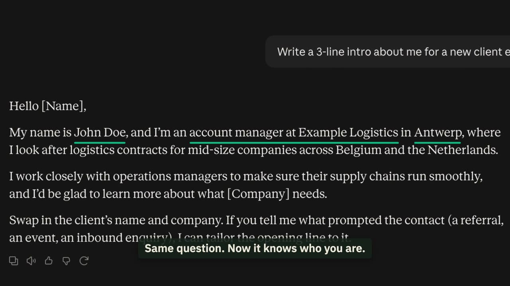

# Starter, step 1: Instructions for Claude

Tell Claude once who you are and how you want answers. It keeps this in mind in every chat.

| | |
|---|---|
| Time to set up | about 10 minutes |
| You need | a Claude account on claude.ai |
| Tested | claude.ai in Chrome, 13 Oct 2026 |

## Instructions and memory: two different things

Claude has two ways to know you:

- **Instructions**: what you tell it, on purpose. You write them, you see them, you change them. This step.
- **Memory**: what Claude picks up from your past chats, by itself. That is step 4.

In our test both were off at the start, so only the instructions could change the answer.

## Where

claude.ai > Settings > Account > Instructions for Claude

## How to use the template

1. Open [template.txt](template.txt) and click the copy button (top right of the file).
2. Paste it into Notes or Word and replace every `[bracket]` with your own details. Delete the lines you don't need.
3. Paste the result into Settings > Account > Instructions for Claude and click "Save changes".

Not sure what to write? See the filled example: [example-john-doe.txt](example-john-doe.txt).

## Test it: the same question, before and after

Open a new chat and ask: "Write a 3-line intro about me for a new client email."

**Before**, no instructions: Claude does not know you, so it writes `[Your Name]` and `[Company/your business]`.

![Before: Claude answers with placeholders like [Your Name]](images/before.jpg)

**After**, with the John Doe example saved: same question, and Claude knows his name, role, company and city.

The brackets left in the after picture are the client's name and company. Claude cannot know those; you add them in
the chat.

## Change or remove it

Go back to Settings > Account > Instructions for Claude, edit or clear the text, and click "Save changes". New chats
use the new version.

## Keep out of it

- Passwords, API keys, and client or patient data.
- Today's task: that goes in the chat.
- Files for one job: those go in a project (step 2).

## Time win and solution win

- Time win: you stop explaining who you are in every chat (our estimate: 1 to 2 minutes per chat).
- Solution win: answers in your tone, the answer first, and no made-up facts.

## Next

Claude knows you now. But it still forgets your files.
**Step 2 (14 Oct 2026): Projects. We give Claude its own desk.**
