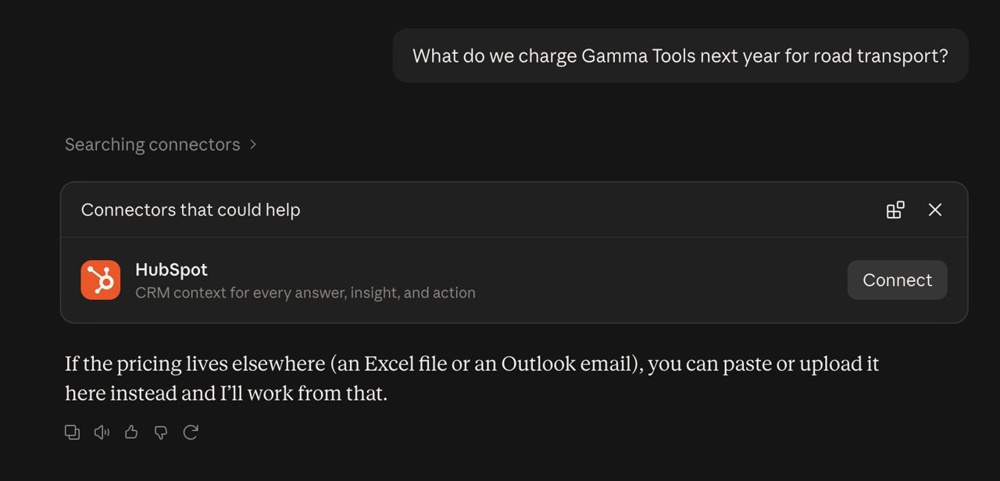
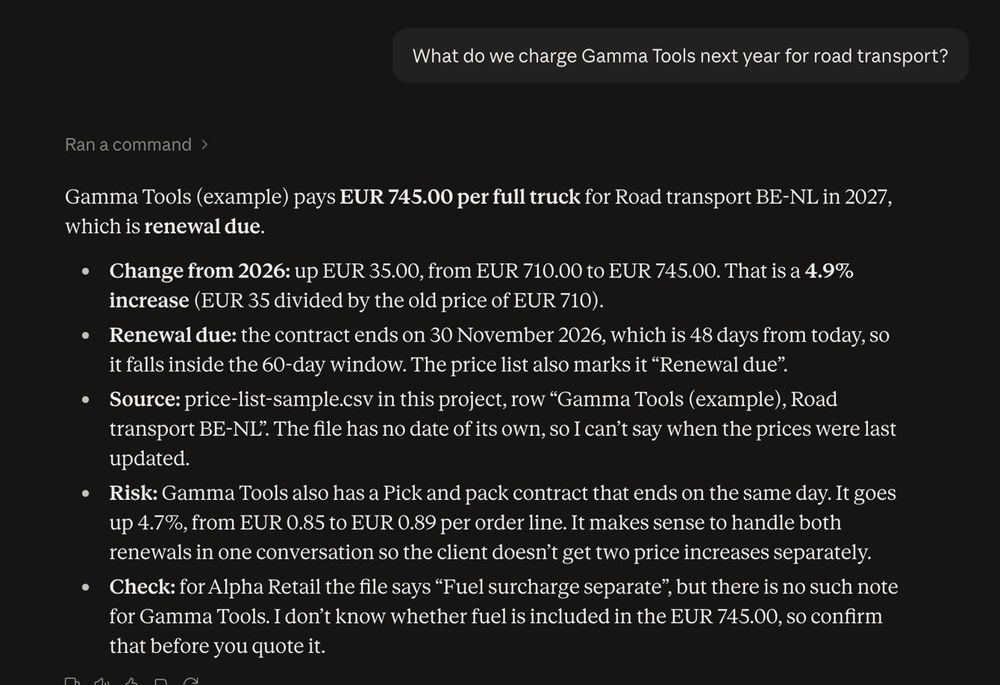

# Starter, step 2: Projects, Claude's own desk

A project is a separate workspace in Claude for one job. It has its own instructions and its own files, and every
chat inside the project can use them.

| | |
|---|---|
| Time to set up | about 10 minutes |
| You need | a Claude account on claude.ai. Free plans can have up to 5 projects |
| Tested | claude.ai in Chrome, Team plan, 13 Oct 2026 |
| Download | [the carousel as a PDF](starter-step2-projects-carousel.pdf) (6 slides) |

## What goes where

- **Instructions for Claude** (step 1): who you are. Used in every chat.
- **A project**: one job, with the rules and the files for that job.
- **The chat**: today's question.

## Where

claude.ai > left sidebar > Projects > New project

## How

1. Click **Projects** in the left sidebar, then **New project**. Give it a name, for example "Renewals", and click
   **Create project**.
2. In the panel on the right, click **+** next to **Instructions**. Paste
   [project-instructions.txt](project-instructions.txt), change it to your own job, and click **Save instructions**.
3. Click **+** next to **Context**, then **Upload from device**, and pick your file. To test first, use
   [price-list-sample.csv](price-list-sample.csv). All clients in it are made up.
4. Ask your question in the chat box at the top of the project page. That chat belongs to the project.

## Test it: the same question, before and after

Ask: "What do we charge Gamma Tools next year for road transport?"

**Before**, in a plain chat outside the project: Claude does not have the price list, so it cannot know.

**After**, in a chat inside the project: EUR 745 per full truck, up from EUR 710 (+EUR 35, +4.9%), and the contract
ends on 30 Nov 2026, so the renewal is due. It names its source, the row in the price list, and it flags two things we
did not ask: a second Gamma Tools contract that ends the same day, and an unclear fuel surcharge.

## Looks the same?

- The before answer gives a price anyway? Ask "Where does that number come from?". If it is not in a file, it was a
  guess.
- The after answer misses the file? Check that the file shows under Context, and that you asked from the project
  page, not from the main chat list. A project chat shows the project name above it ("Renewals / ...").

## Good to know

- Files you can add: PDF, DOCX, CSV, TXT, HTML, ODT, RTF, EPUB, JSON and XLSX. Excel files (XLSX) need code execution
  and file creation turned on in your settings. CSV works without it.
- When a project gets big, Claude switches to a search mode by itself, so it can use up to about 10 times more files.
- On Team and Enterprise plans you can share a project with people in your organization.

## Keep out of it

- Passwords, API keys, and client or patient data your company does not allow in Claude.
- Files from another job: give that job its own project.

## Time win and solution win

- Time win: you stop pasting the same file into every chat (our estimate: 5 minutes a day).
- Solution win: the answer comes from your own file, so you can check it.

## Next

It has a desk now. But is it the right Claude for the job?
**Step 3 (15 Oct 2026): Which Claude for which job.**
