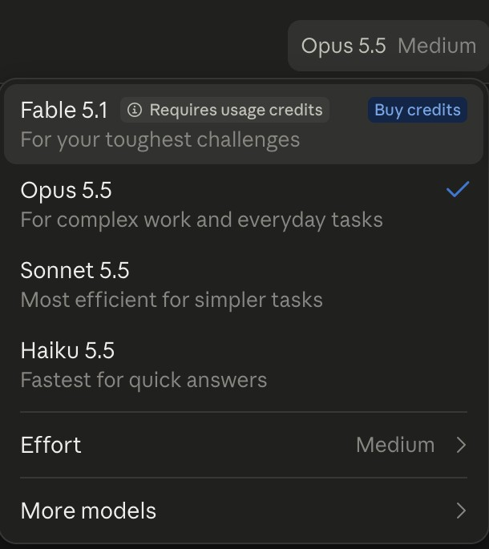
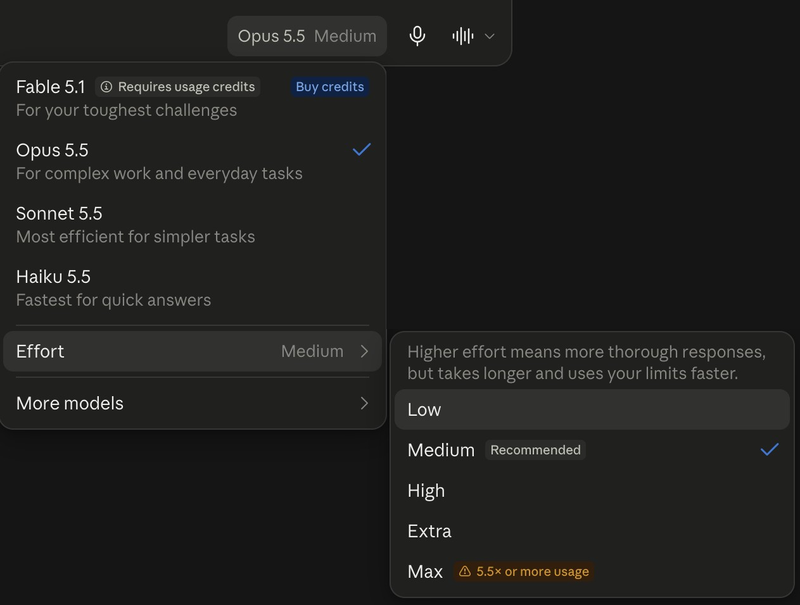
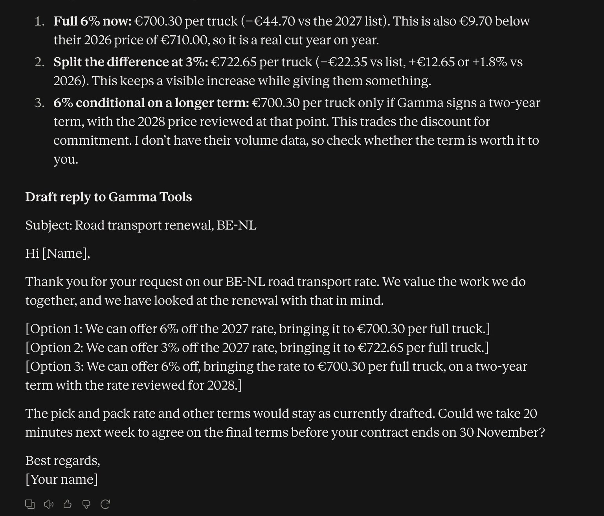
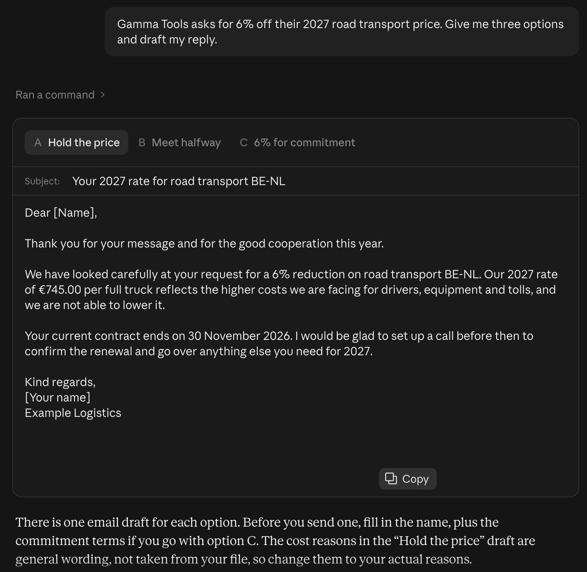

# Starter, step 3: Which Claude for which job

Claude is not one model. It is a family, and you pick the model for each chat. You can also pick the effort: how
hard it thinks before it answers.

| | |
|---|---|
| Time to learn | about 5 minutes |
| You need | a Claude account on claude.ai. Which models you see depends on your plan |
| Tested | claude.ai in Chrome, Team plan, 14 Oct 2026 |

## Where

claude.ai > the chat box > click the model name next to the send button (for example "Opus 5.5 Medium").

## The models (14 Oct 2026)

What the menu says, plus the release date from Anthropic's docs.

| Model | Out since | The menu says | Use it for |
|---|---|---|---|
| Haiku 5.5 | 7 Oct 2026 | Fastest for quick answers | A quick check, a short rewrite, a yes or no |
| Sonnet 5.5 | 28 Sep 2026 | Most efficient for simpler tasks | Everyday writing and summaries |
| Opus 5.5 | 22 Sep 2026 | For complex work and everyday tasks | Work you will send or decide on. Anthropic's advice: not sure? Start with Opus |
| Fable 5.1 | 1 Sep 2026 | For your toughest challenges | The hardest reasoning. On our Team plan it runs on usage credits, billed separately from the plan |

## Effort

Effort sits in the same menu. Low, Medium (recommended), High, Extra and Max. The menu explains it: higher effort
means more thorough answers, but it takes longer and uses your limits faster. Max warns "5.5x or more usage".

Start on Medium. Go higher only when an answer misses something.

## Test it: the same question, two models

In the "Renewals" project from [step 2](../02-projects/), ask:

"Gamma Tools asks for 6% off their 2027 road transport price. Give me three options and draft my reply."

**Haiku 5.5** (about 15 seconds in our test): the right numbers. It spots that 6% off (EUR 700.30) is EUR 9.70
below this year's price of EUR 710.00. But it also puts every client from the price list in a table, not just Gamma
Tools, and writes one draft with the three options in brackets.

**Opus 5.5, effort Medium** (about 25 seconds): a full email for each option ("Hold the price", "Meet
halfway", "6% for commitment"). You still fill in the names. And it says which sentences are general wording, not from your file.

Your answers will not be word for word the same. Models answer a little differently every time.

## Rule of thumb

- A quick check or a short answer: Haiku.
- Something you will send, sign or decide on: Opus.
- Not sure: Opus on Medium, as Anthropic advises.

## Good to know

- The model is set per chat. A new chat starts with the model you picked last.
- Which models you see depends on your plan. "More models" in the menu shows older ones.

## Time win and solution win

- Time win: the fast model for quick jobs (in our test: about 15 seconds instead of 25).
- Solution win: depth only where you need it, so your usage limits go to the work that matters.

## Next

Right model, right job. But what does Claude remember about you?
**Step 4 (16 Oct 2026): Memory.**
