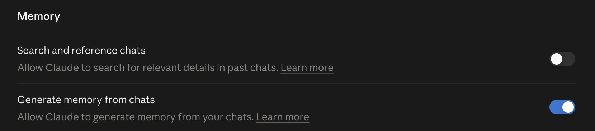
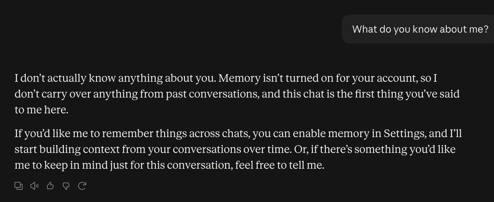
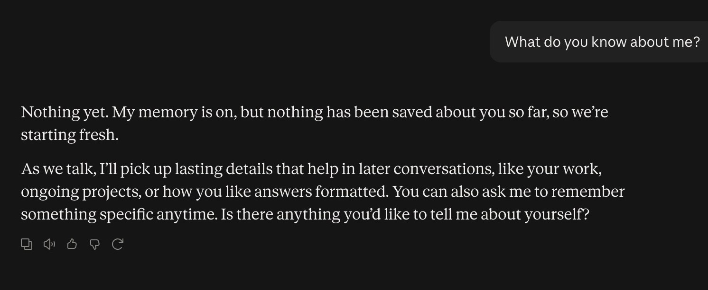
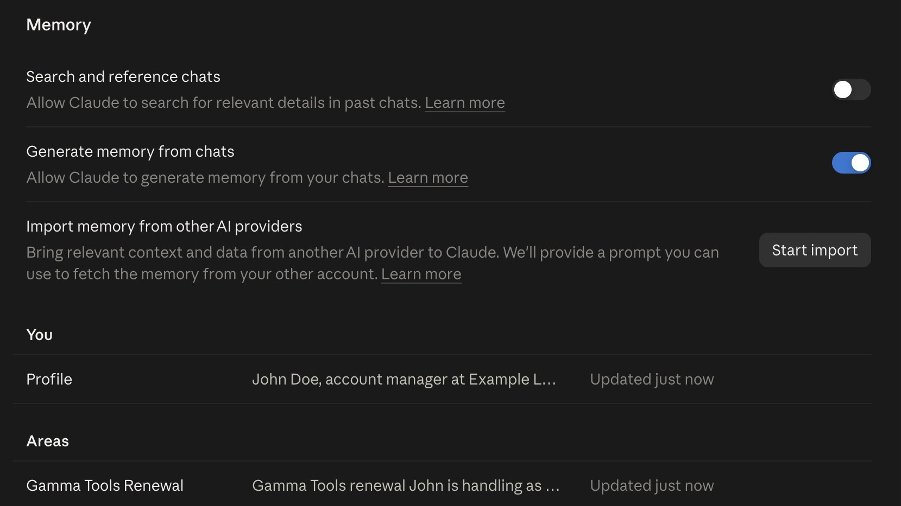
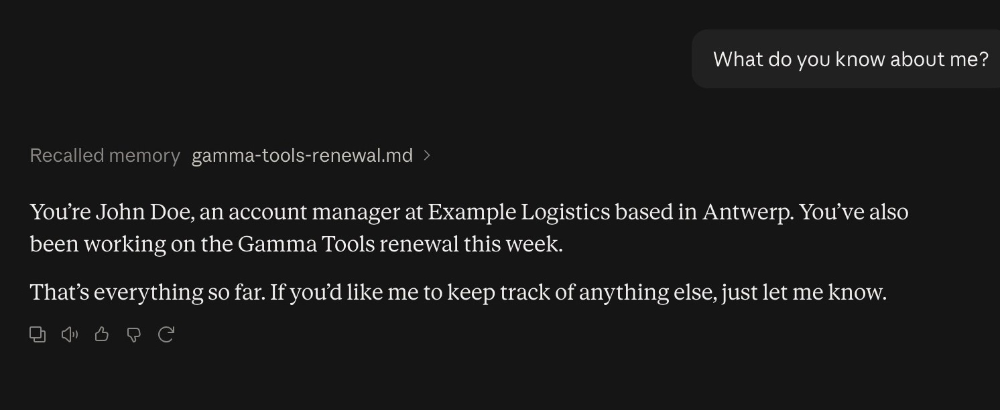

# Starter, step 4: Memory

Memory is what Claude keeps from your chats. It is different from step 1: there you wrote the instructions
yourself. Here, Claude takes the notes.

| | |
|---|---|
| Time to check | about 5 minutes |
| You need | a Claude account on claude.ai |
| Tested | claude.ai in Chrome, Team plan, 15 Oct 2026 |
| Download | [the carousel as a PDF](starter-step4-memory-carousel.pdf) (7 slides) |

## Is yours on?

On the Free, Pro and Max plans memory is on by default. On Team and Enterprise plans, each member starts with it
off. (Anthropic's help article, see Sources.)

## Where

claude.ai > Settings > Memory. Two switches:

- **Search and reference chats**: Claude may search your earlier chats for details. Paid plans only.
- **Generate memory from chats**: Claude saves what it learns about you as entries you can read.

## Test it: the same question, three times

Ask in a new chat: "What do you know about me?"

**1. Memory off.** It knows nothing, and says memory is not turned on.

**2. Memory on, after one normal work chat.** We asked for a 3-line plan for the Gamma Tools renewal and introduced
ourselves in the same message. A few minutes later Settings showed "No files yet", and the same question got
"Nothing yet". Memory does not keep everything, and not right away.

**3. Tell it what to remember.** "Remember this: I'm John Doe, account manager at Example Logistics in Antwerp. This
week I'm working on the Gamma Tools renewal." Settings > Memory then showed two entries, both "Updated just now":
a profile under **You** and "Gamma Tools Renewal" under **Areas**.

Same question again: now it knows.

## Change or delete what it kept

- In Settings > Memory, select an entry to read it, then edit it or choose Delete.
- Or type in the box at the bottom ("Tell Claude what to change or remove"), or tell Claude in a chat what to forget.
- **Pause memory**: Claude keeps what it has, but stops using it and stops adding to it.
- **Reset memory**: deletes everything, project memories included. This cannot be undone.

## Good to know

- Each project has its own memory. In a project, Claude uses that project's memory plus your general memory, but
  never another project's.
- Want a chat Claude does not remember? Start an incognito chat: the ghost icon at the top right of a new chat. It is
  not saved to memory or to your chat history.

## Keep out of it

- Passwords, API keys, and client or patient data your company does not allow in Claude.
- If something sensitive got saved, delete that entry.

## Time win and solution win

- Time win: no more repeating last week's context (our estimate: a few minutes a day).
- Solution win: you decide what it keeps, and you can see it.

## Sources

- Anthropic help: [Use Claude's chat search and memory](https://support.claude.com/en/articles/11817273-use-claude-s-chat-search-and-memory-to-build-on-previous-context), read 15 Oct 2026.

## Next

Chat, Cowork or Code: three ways to work with Claude, and when to use which.
**Step 5 (17 Oct 2026).**
