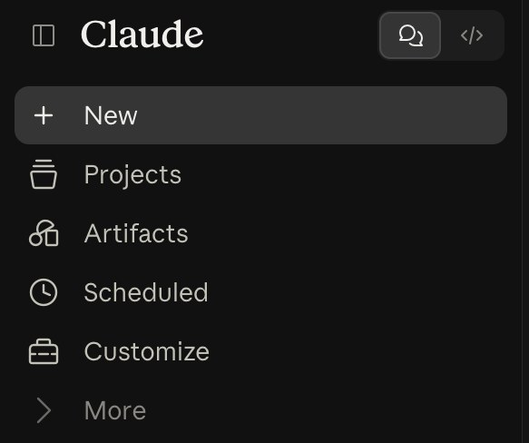
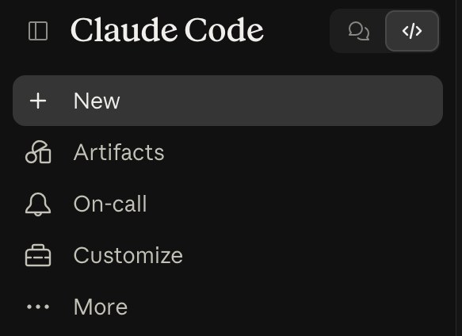

# Starter, step 5: Chat, Cowork, Code

Claude has three ways to work. Pick the one that fits the job.

| | |
|---|---|
| Time to learn | about 5 minutes |
| You need | a Claude account on claude.ai. Chat works on every plan. Cowork and Code need a paid plan |
| Tested | claude.ai in Chrome, Team plan, 16 Oct 2026 |
| Download | [the carousel as a PDF](starter-step5-chat-cowork-code-carousel.pdf) (8 slides) |

## The three ways

| Way | What it does | Plans |
|---|---|---|
| **Chat** | You ask, Claude answers. One question, one answer | All plans |
| **Cowork** | You hand Claude a task with steps, like turning an export into a spreadsheet. In the desktop app it can also work with files in folders you connect | Paid plans |
| **Code** | Claude builds and changes software in a folder or a GitHub repo. In your browser at claude.ai/code, in the desktop app, or in a terminal | Paid plans. On Team and Enterprise: a seat that includes Claude Code |

Anthropic on Cowork: "Claude Cowork uses the same agentic architecture that powers Claude Code, with no terminal
required."

## Where

**Chat and Cowork, or Code:** the switch at the top left of claude.ai.

**Chat or Cowork:** Chat and Cowork share one home. Under the message box, select **Chat** or **Cowork**.

Your message box shows no Chat and Cowork options? Then you have the new version, where Claude decides by itself
whether your message is a quick answer or a task. Anthropic is rolling it out gradually to Pro and Max plans.

## Which way for which job

The one-page table: [which-way-for-which-job.md](which-way-for-which-job.md). Not sure? Start in Chat.

## Good to know

- Cowork sessions keep running when you close the desktop app. If a task uses your local files or your browser,
  keep the desktop app open.
- Cowork can take real actions for you. Check its plan before you let it go ahead, especially with sensitive files.
- Claude Code is not on the Free plan.

## Keep out of it

- Passwords, API keys, and client or patient data your company does not allow in Claude.
- Give Cowork only the folders it needs for the task.

## Time win and solution win

- Time win: no more pushing a 10-step task through a chat, one copy-paste at a time (our estimate: 15 minutes per
  task).
- Solution win: answers in Chat, tasks in Cowork, software in Code.

## Sources

- Anthropic help: [Get started with Claude Cowork](https://support.claude.com/en/articles/13345190), read 16 Oct 2026.
- Claude Code docs: [Overview](https://code.claude.com/docs/en/overview), read 16 Oct 2026.

## Next

Artifacts: Claude makes something you can share. You send one link.
**Step 6 (18 Oct 2026).**
