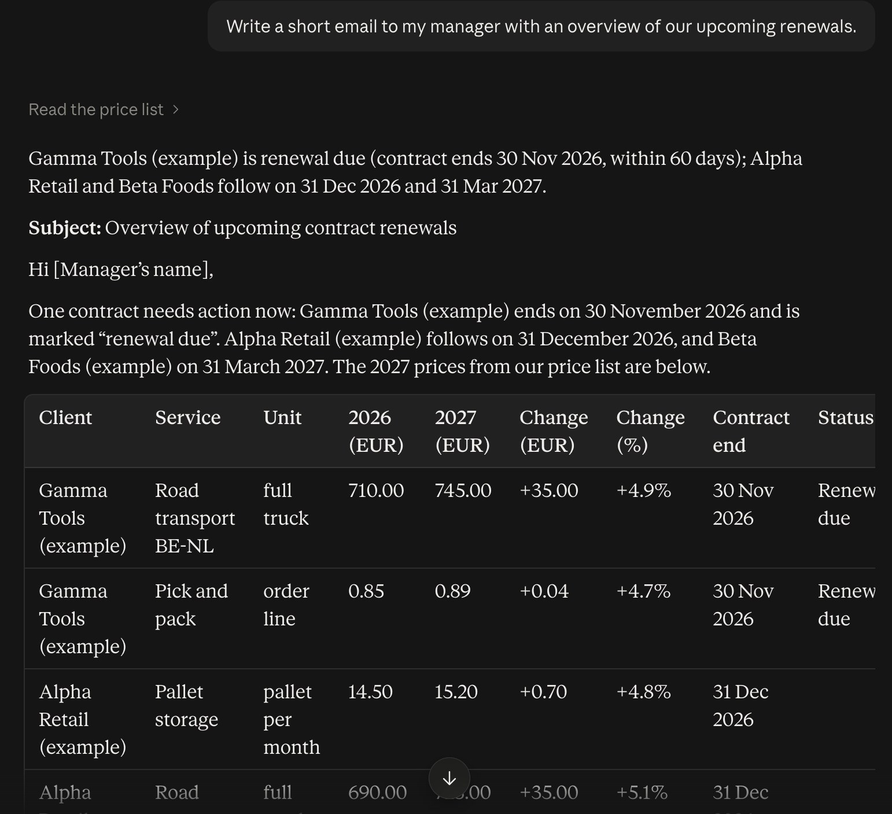
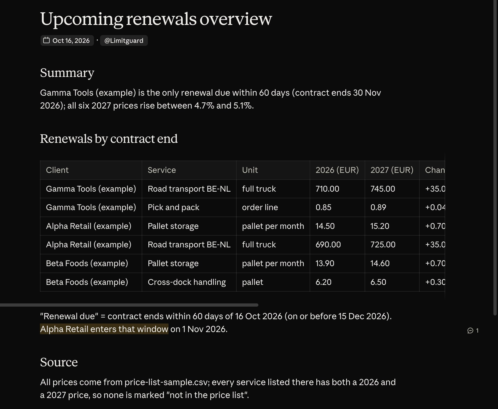
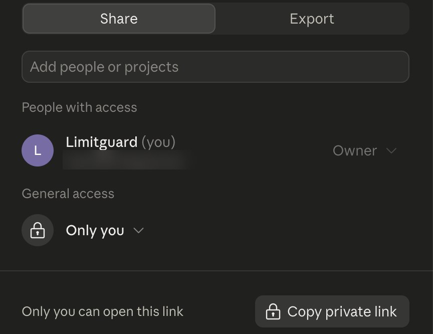
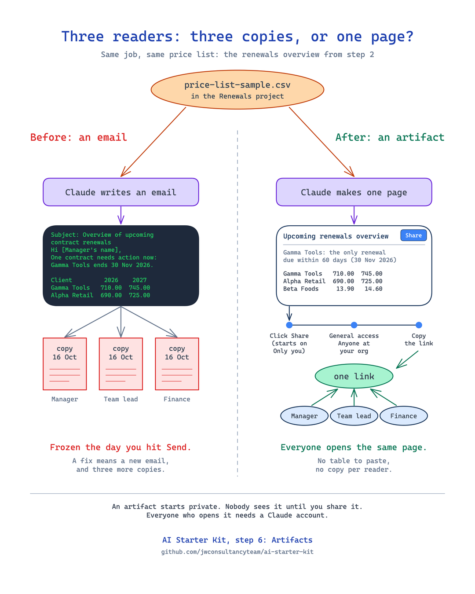

# Starter, step 6: Artifacts

Anthropic: "An artifact is anything Claude makes for you that you'd put in front of someone: a design, a deck, a
document, a dashboard, or a small interactive tool." It opens beside your chat. You can edit it, come back to it, and
share it.

| | |
|---|---|
| Time to set up | about 5 minutes |
| You need | a Claude account on claude.ai. For the test below: the Renewals project from [step 2](../02-projects/) |
| Tested | claude.ai in Chrome, Team plan, 16 Oct 2026 |
| Download | [the carousel as a PDF](starter-step6-artifacts-carousel.pdf) (5 slides) |

## Where

- **Make one:** ask for it in any chat, for example "...as an artifact".
- **Find it again:** claude.ai > left sidebar > **Artifacts**.

## Test it: the same job, before and after

Both chats are in the Renewals project, with the sample price list from step 2. All clients in it are made up.

**Before.** Ask: "Write a short email to my manager with an overview of our upcoming renewals."
A good email, with a table to paste. Your manager gets a copy that ages.

**After.** One change. Ask: [prompt.txt](prompt.txt), "Make a one-page overview of our upcoming renewals as an
artifact, so I can share it with my manager."
Claude read the price list and made one page beside the chat: a summary, the renewals by contract end, what "renewal
due" means, and the source file.

Change something? Ask in the chat ("Change the title to: Upcoming renewals overview"), or edit the page itself.

## Share it

It starts private. Nobody sees it until you share it.

1. Open the artifact and click **Share** at the top right.
2. Under **General access** (the help article calls it **Who has access**), choose who can open it. It starts on
   **Only you**.
3. Copy the link and send it.

- Pro and Max plans: "Only you" or "Anyone with the link", or invite people by email.
- Team and Enterprise plans: "Only people invited" or "Anyone at" your organization. "Anyone with the link" works
  only when an owner has turned on external sharing.
- Everyone who opens it needs a Claude account, also with the link.
- You cannot change sharing settings in the iOS or Android app. Use the web or the desktop app.

## In one picture

Three readers. An email gives each one a copy. An artifact gives everyone the same page.

Drawn with Excalidraw. To change it, open [copies-vs-page.excalidraw](images/copies-vs-page.excalidraw) on
excalidraw.com.

## No artifact?

- Ask for it by name: "...as an artifact".
- Artifacts need **Cloud code execution and file creation** on: Settings > Capabilities (Free, Pro, Max). On Team
  and Enterprise plans an owner sets it in Organization settings > Capabilities.

## Keep out of it

- Passwords, API keys, and client or patient data your company does not allow in Claude.
- Check every number on the page before you share it. Claude can make mistakes.

## Time win and solution win

- Time win: no more building a slide for a quick update (our estimate: 20 minutes per update).
- Solution win: your manager opens the page, not an old screenshot.

## Sources

- Anthropic help: [What are artifacts and how do I use them?](https://support.claude.com/en/articles/9487310), read 16 Oct 2026.
- Anthropic help: [Share artifacts](https://support.claude.com/en/articles/9547008), read 16 Oct 2026.
- Settings > Capabilities on our Team plan, 16 Oct 2026: "share chat and Cowork artifacts with your organization".

## Next

Connectors: Claude reads your calendar. Start with a test calendar.
**Step 7 (19 Oct 2026).**
