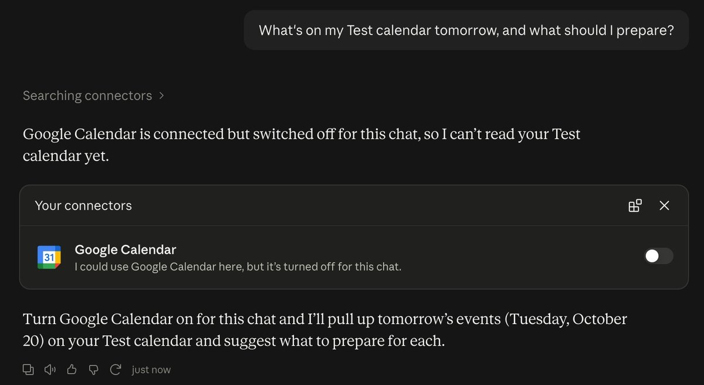
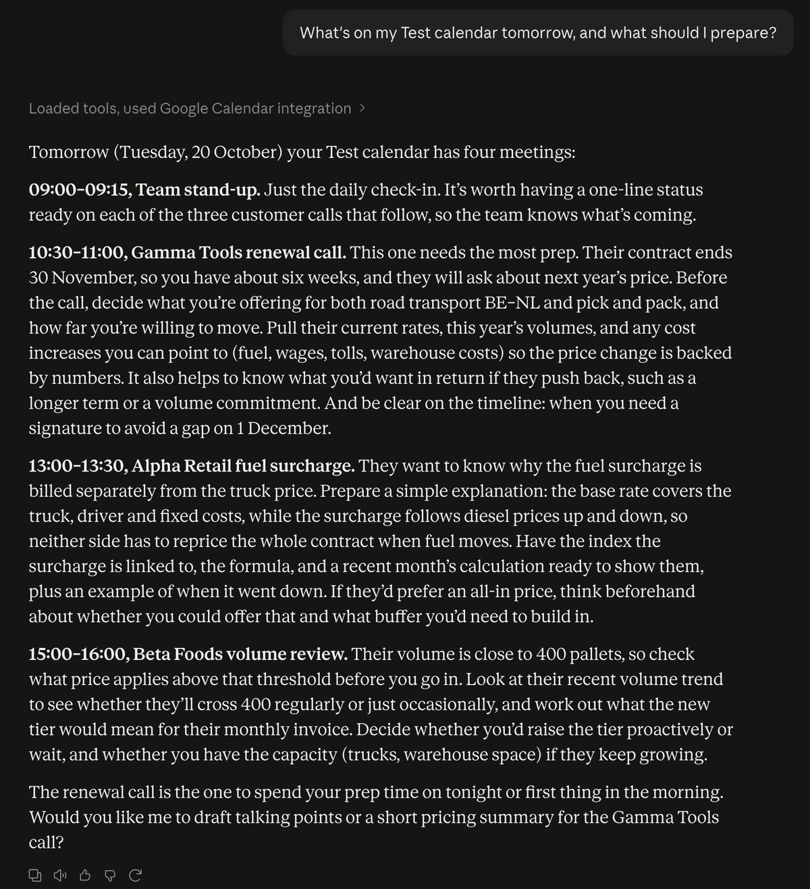
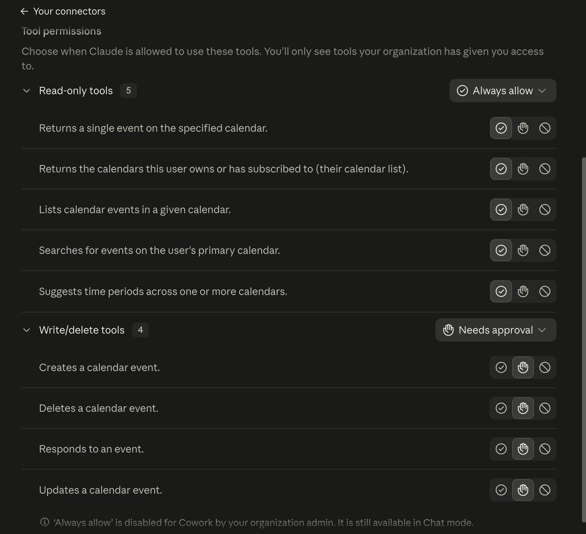

# Starter, step 7: Connectors

A connector links Claude to another app, like your calendar, your mail or your files. Claude can find things there,
and some connectors can also make changes for you. You choose which app, and you can disconnect it at any time.

This step connects one calendar. Start with a test calendar, not your real one.

| | |
|---|---|
| Time to set up | about 10 minutes, including the test calendar |
| You need | a Claude account on a Pro, Max, Team or Enterprise plan, and a Google account for the test calendar |
| Tested | claude.ai in a Chromium browser, Team plan, 19 Oct 2026 |
| Download | [the carousel as a PDF](starter-step7-connectors-carousel.pdf) (6 slides) |

## Where

1. claude.ai > **Customize** > **Connectors**.
2. Find **Google Calendar** (under **Discover**, or under **Yours** when your organization already added it) and click **Connect**.
3. Sign in with your Google account and approve the access.
4. In a chat: **+** at the lower left of the message box > **Connectors** > switch **Google Calendar** on.

Team and Enterprise plans: an Owner first adds the connector for the organization. An Owner sees **Connect for your
team**. To try it alone first, click the arrow next to it and pick **Connect just for me**.

## First: a test calendar

Claude reads the calendars of the Google account you connect. A second calendar inside your real account does not
keep your real meetings out of reach. Best: a separate Google account with nothing real in it.

No spare account? Make a separate calendar named **Test** in Google Calendar and name it in your question, as we did
for the screenshots below. Claude can still read your other calendars, so only do this on an account you are allowed
to connect.

Add the four made-up meetings from [test-calendar-events.md](test-calendar-events.md) for tomorrow. All clients in
them are made up, the same as the price list in [step 2](../02-projects/).

## Test it: the same question, before and after

Ask: "What's on my Test calendar tomorrow, and what should I prepare?"

**Before.** Connector off in this chat. Claude can't read the calendar and offers to switch the connector on.

**After.** Connector on. Same question. All four meetings, with what to prepare for each.

## Before you trust it: the tool permissions

The Google Calendar connector is made by Google. On claude.ai it lists these tools (read on 18 Oct 2026):

| Reads ("Read-only tools") | Changes ("Write/delete tools") |
|---|---|
| `list_calendars`, `list_events`, `search_events`, `get_event`, `suggest_time` | `create_event`, `update_event`, `delete_event`, `respond_to_event` |

So it can do more than read. Set what it may do on its own:

1. **Customize** > **Connectors** > **Google Calendar** > **Tool permissions**.
2. Pick **Always allow**, **Needs approval** or **Blocked**, per group of tools or per tool.
3. Our pick: reads on **Always allow**, changes on **Needs approval**. On our account it was already set this way
   when we connected (19 Oct 2026). Check it on yours.

When Claude wants to use a tool that needs approval, it asks first. **Allow once** lets it go this one time.
**Always allow** skips the question from then on. Do not pick that for a tool that changes things.

The full list: [connector-safety-checklist.md](connector-safety-checklist.md).

## Turn it off

- One chat: **+** > **Connectors** > switch it off. It stays connected.
- Everywhere: **Customize** > **Connectors** > **Google Calendar** > **Disconnect**.

## Keep out of it

- Your real calendar, until the test run does what you expect.
- Calendars with client or patient data your company does not allow in Claude.
- Check every date and time Claude gives you. Claude can make mistakes.

## Time win and solution win

- Time win: no more copying your agenda into a chat (our estimate: 3 minutes every morning).
- Solution win: answers from your live calendar, and you approve every change.

## Sources

- Claude docs: [Google Calendar](https://claude.com/docs/connectors/google/calendar), read 18 Oct 2026. Plans: Pro,
  Max, Team, Enterprise. Note: this page says the connector is read-only. The connector page on claude.ai lists tools
  that create, update and delete events (18 Oct 2026). Trust the Tool permissions page in your own account.
- Claude docs: [Get started with connectors](https://claude.com/docs/connectors/getting-started), read 18 Oct 2026:
  Customize > Connectors, the + menu, Allow once and Always allow, the tool permissions.
- Anthropic help: [Use Google Workspace connectors](https://support.claude.com/en/articles/10166901), read 18 Oct 2026.

## Next

Skills: the same job every week? Teach Claude the job once.
**Step 8 (20 Oct 2026).**
