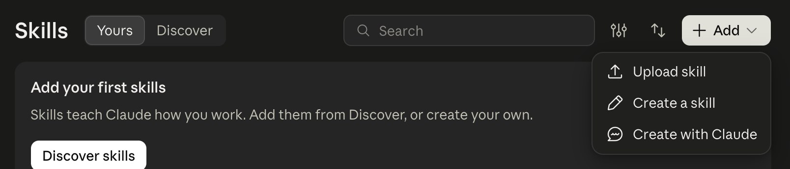
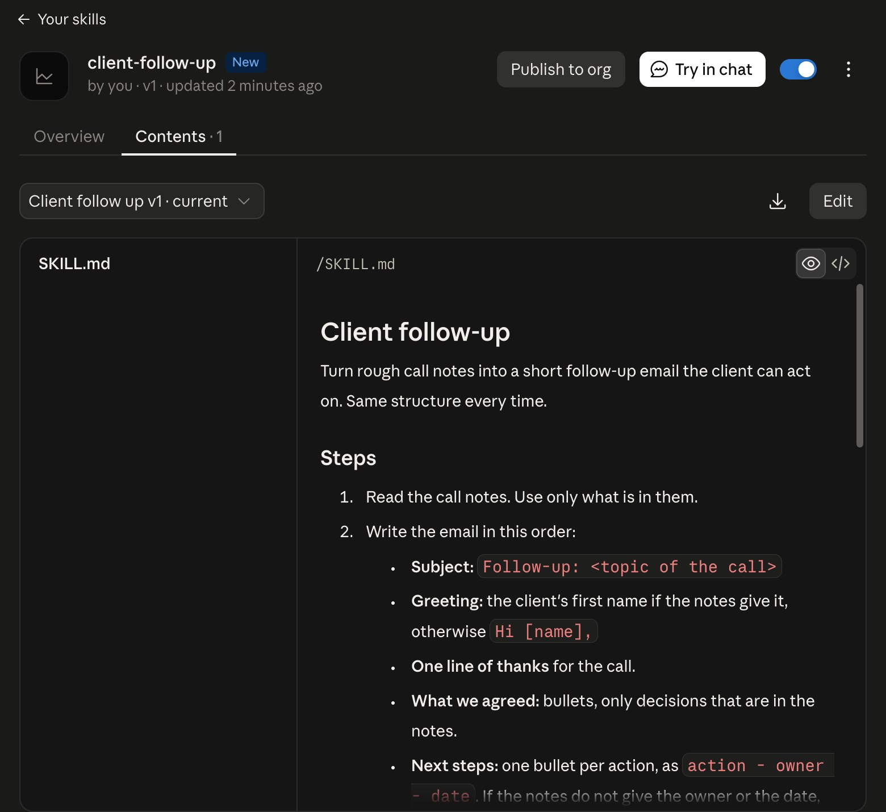
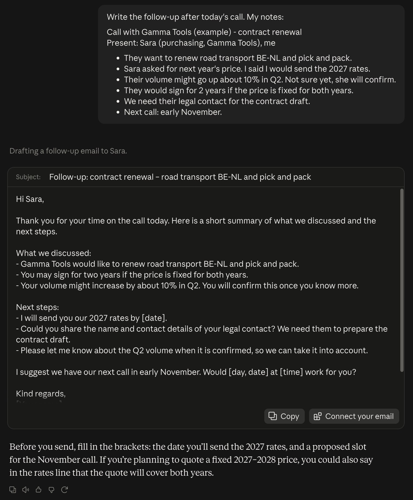
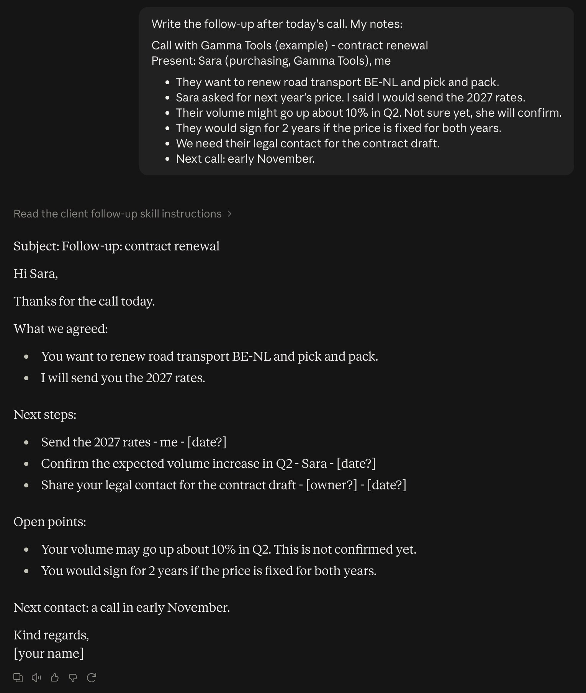

# Starter, step 8: Skills

A skill is a small folder with written steps for one job. Claude reads it when that job comes up, and follows it. You
write the job down once, and you stop explaining it in every chat.

This step uploads one free skill: a follow-up email after a client call.

| | |
|---|---|
| Time to set up | about 5 minutes |
| You need | a Claude account (Skills work on Free, Pro, Max, Team and Enterprise) |
| Tested | claude.ai in a Chromium browser, Team plan, 19 Oct 2026 |
| Download | [client-follow-up.zip](client-follow-up.zip), ready to upload, and [the carousel as a PDF](starter-step8-skills-carousel.pdf) (7 slides) |

## Where

1. claude.ai > **Customize** > **Skills**.
2. **+ Add** (top right) > **Upload skill**.
3. Pick [client-follow-up.zip](client-follow-up.zip). Claude shows a preview with the name and the description.
   Click **Upload**.
4. Check that the switch next to the skill is on.

Team and Enterprise: **Publish to org** on the skill page shares it with your organization. An Owner controls this
under Organization settings.

## What is in the skill

One file: [client-follow-up/SKILL.md](client-follow-up/SKILL.md). Plain text, so read it before you upload it.

- **name** and **description** at the top. Claude picks a skill by its description, so the description says what the
  skill does and when to use it.
- **Steps**: the order of the email, `action - owner - date` per next step, `[owner?]` and `[date?]` when the notes
  do not say, and a check: at most 150 words, nothing that is not in the notes.
- **An example** with a made-up client.

## Test it: the same message, before and after

Send this in a new chat, with the notes from [call-notes-sample.txt](call-notes-sample.txt):

"Write the follow-up after today's call. My notes:" followed by the notes. Gamma Tools is a made-up client, the same
as in [step 2](../02-projects/).

**Before.** No skill. A good draft, but no owner per action and no list of what is still open.

**After.** Skill uploaded, same message. Claude reads the skill first ("Read the client follow-up skill
instructions"). Next steps as action, owner, date. What is not agreed yet sits under open points. Where the notes do
not name the owner, it writes `[owner?]` instead of guessing.

This is one run of each. Claude can still make mistakes: read every email before you send it.

## Make your own

1. Pick one job you explain to Claude every week.
2. Copy the `client-follow-up` folder and rename it. The folder name and the `name` line must be the same: lowercase
   letters, numbers and hyphens.
3. Write the `description` (max 200 characters): what the skill does, and when to use it.
4. Write the steps as you would for a new colleague. Add one short example.
5. Zip the folder (the folder itself, not only the file inside) and upload it.

No zip tool? **+ Add** > **Create a skill** lets you write it on claude.ai, and **Create with Claude** builds one with
you in a chat.

## Keep out of it

- Skills from sources you do not trust. A skill can tell Claude what to do with your data. Read it first.
- Passwords, keys or client data inside the skill file.
- Prices or terms the skill makes up: the steps here say "nothing that is not in the notes" for that reason.

## Time win and solution win

- Time win: no more fixing the layout of each follow-up (our estimate: 10 minutes per email).
- Solution win: the same structure every time, with an owner and a date per action, and open points that are clearly
  open.

## Sources

- Anthropic help: [Using skills in Claude](https://support.claude.com/en/articles/12512180-using-skills-in-claude),
  read 19 Oct 2026. Plans: Free, Pro, Max, Team and Enterprise.
- Anthropic help: [How to create custom skills](https://support.claude.com/en/articles/12512198-how-to-create-custom-skills),
  read 19 Oct 2026: the SKILL.md format, the name and description limits, the zip layout.
- The claude.ai Skills page itself, 19 Oct 2026: **Customize** > **Skills** > **+ Add** with **Upload skill**,
  **Create a skill** and **Create with Claude**. Some help pages still name Settings > Capabilities: on our account
  that page now says Skills moved to Customize.

## Next

A skill is a recipe. In Cowork, Claude cooks the whole meal.
**Step 9 (21 Oct 2026).**
