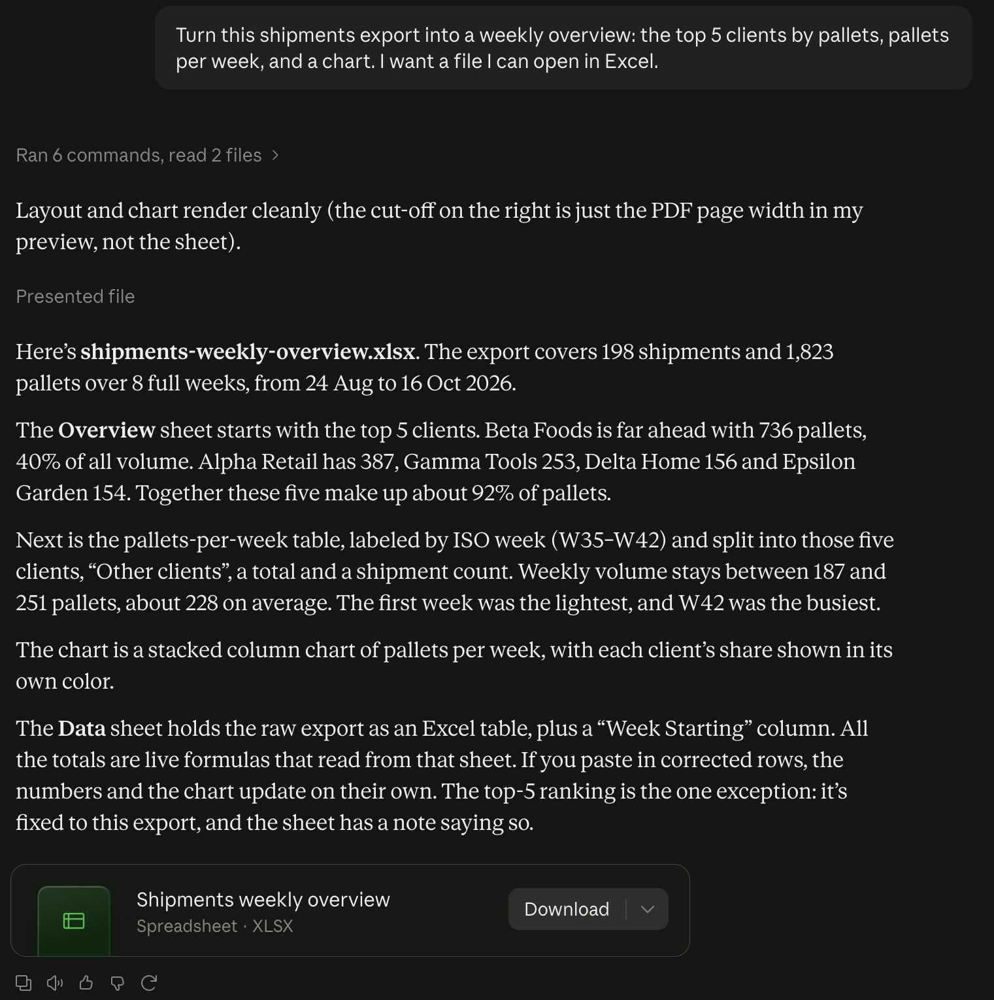
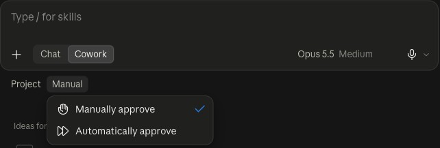
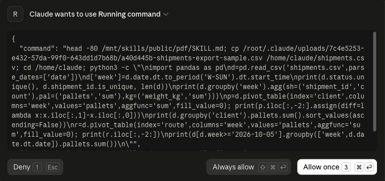
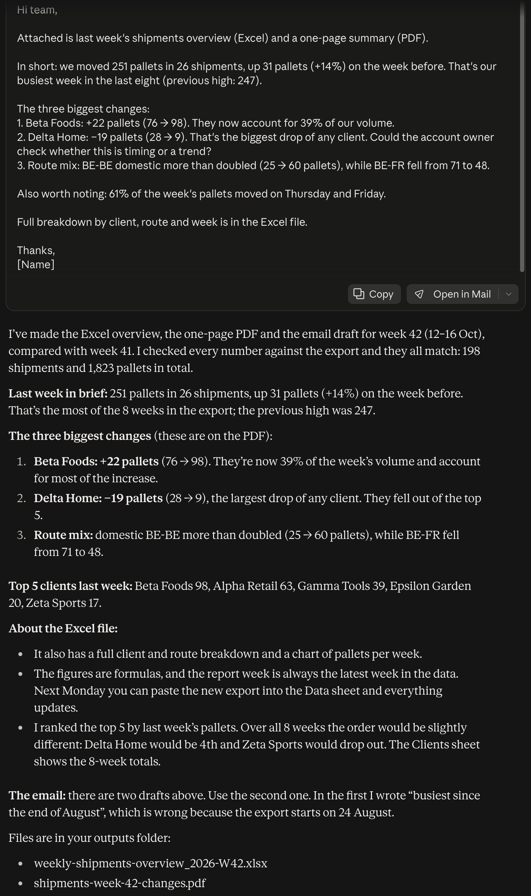

# Starter, step 9: Cowork, a task with steps

In Cowork you hand Claude a task, not a question. Claude plans the steps, runs them, and hands you the files.

This step gives Claude a weekly report job with three outputs, on a made-up shipments export.

| | |
|---|---|
| Time to set up | about 10 minutes, including the check of the numbers |
| You need | a Claude account on a paid plan (Pro, Max, Team or Enterprise). Cowork on claude.ai is marked Beta |
| Tested | claude.ai in a Chromium browser, Team plan, 19 Oct 2026 |
| Download | [shipments-export-sample.csv](shipments-export-sample.csv), [task-prompt.txt](task-prompt.txt), [expected-numbers.md](expected-numbers.md) and [the carousel as a PDF](starter-step9-cowork-carousel.pdf) (7 slides) |

## First: is it a Chat job?

We asked Chat first: "Turn this shipments export into a weekly overview: the top 5 clients by pallets, pallets per
week, and a chart. I want a file I can open in Excel." Chat made the Excel file, with the right numbers. Under the
answer, claude.ai suggested to try Cowork next time.

So for one answer or one file, Chat is enough. Cowork is for a job with several steps and several outputs.

## Where

1. claude.ai > **New**.
2. Under the message box, select **Cowork** (next to **Chat**).
3. Under the message box, **Manual** sets how Claude runs steps:
   - **Manually approve**: Claude asks before it runs a step.
   - **Automatically approve**: it does not ask.

Start with **Manually approve**.

## The task

Attach [shipments-export-sample.csv](shipments-export-sample.csv) and paste [task-prompt.txt](task-prompt.txt):

"Every Monday I report on last week's shipments. From this export: 1) build the weekly overview in Excel (top 5
clients by pallets, pallets per week, a chart), 2) make a one-page PDF for the team with the three biggest changes in
the last week compared with the week before, 3) write a short email to the team to send with it. Check your numbers
against the export before you finish."

**It asks first.** With **Manually approve**, Claude showed the step it wanted to run and waited: **Deny**,
**Always allow** or **Allow once**. We picked **Allow once**. In our run it asked once.

**The result.** About 4 minutes after we sent it: the Excel overview, a one-page PDF with the three biggest changes,
and the email draft. It wrote two email drafts and said to use the second: in the first it had called the week
"busiest since the end of August", which is wrong because the export starts on 24 August.

We checked every number against [expected-numbers.md](expected-numbers.md), counted with a script, not by Claude.
All of them matched. This is one run. Check your own numbers before you send anything.

## Keep out of it

- Client or patient data your company does not allow in Claude. Test with the sample export first.
- **Always allow** for steps you have not seen yet. Look at the first runs before you let it run on its own.
- Sending the email from Cowork. Read it, then send it yourself.

## Time win and solution win

- Time win: the Monday report in one task instead of three jobs by hand (our estimate: 45 minutes a week).
- Solution win: the same three outputs every week, with the numbers checked against the export.

## Sources

- Anthropic help: [Get started with Claude Cowork](https://support.claude.com/en/articles/13345190), read 16 Oct 2026.
- The claude.ai composer itself, 19 Oct 2026: **Chat** and **Cowork** under the message box, **Manually approve** and
  **Automatically approve**, and the **Deny**, **Always allow** and **Allow once** buttons.

## Next

The same task, every Monday at 07:00.
**Step 10 (22 Oct 2026).**
