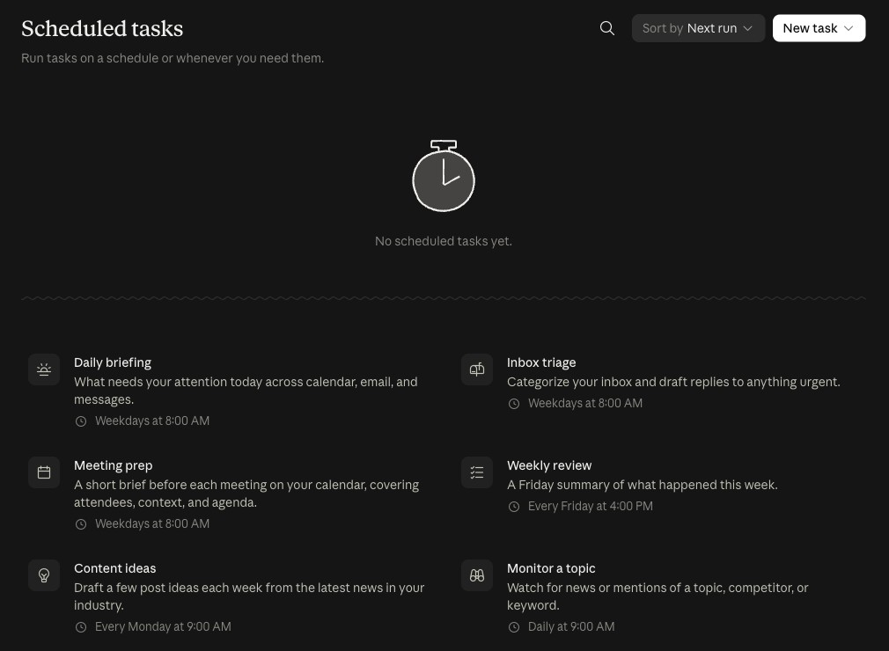
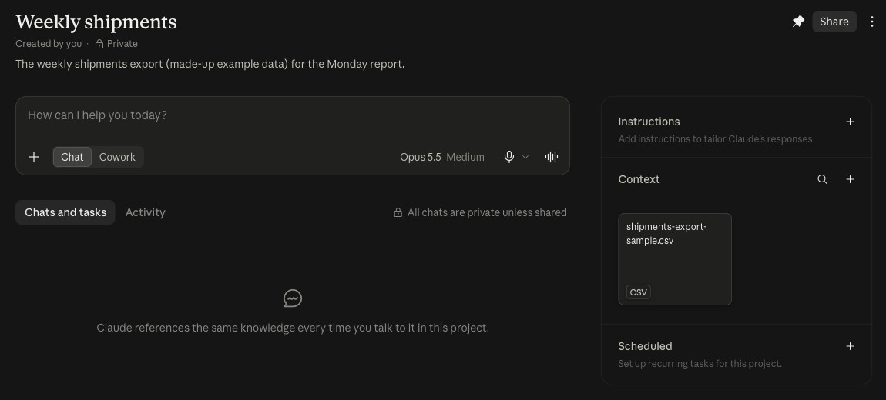
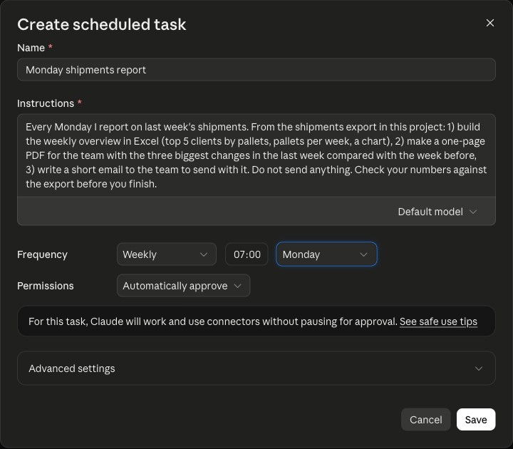
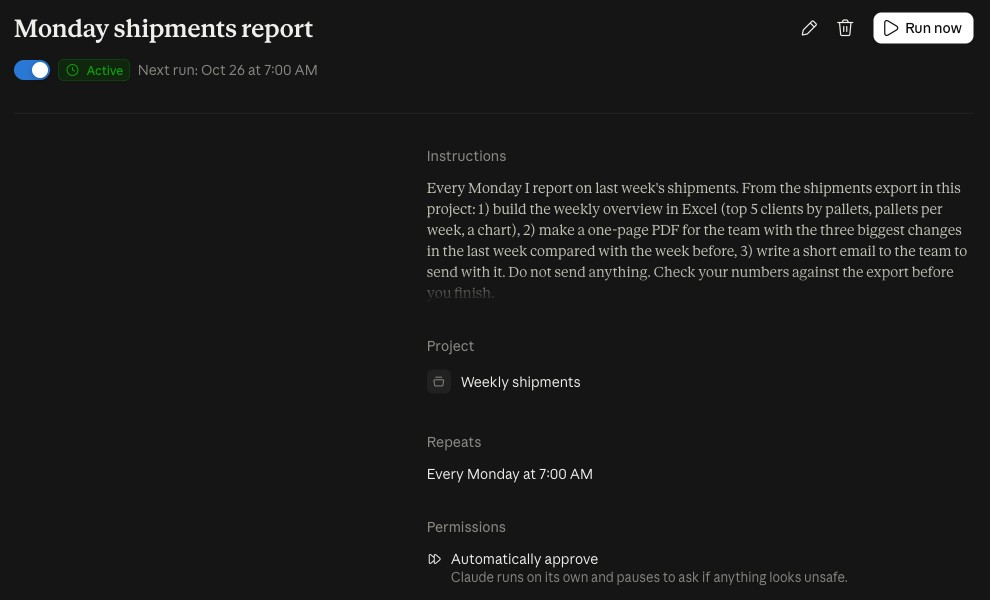
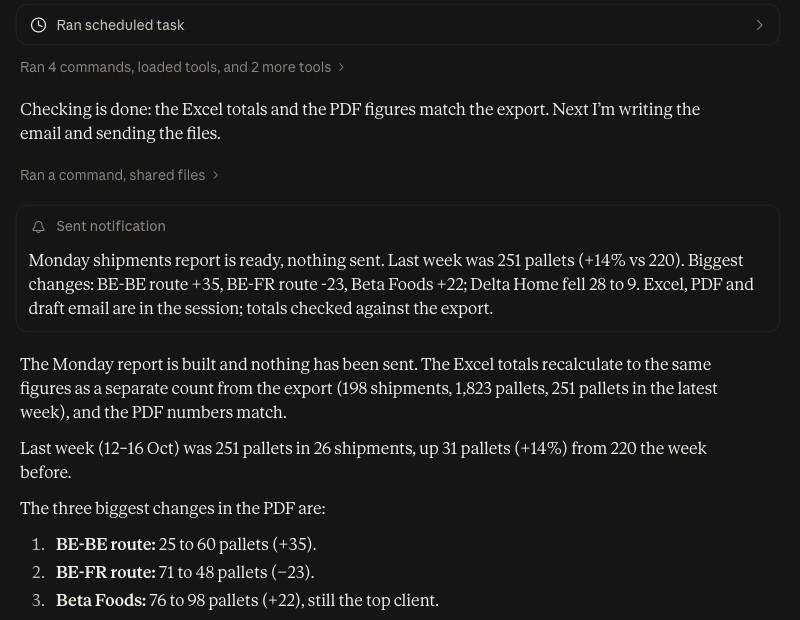
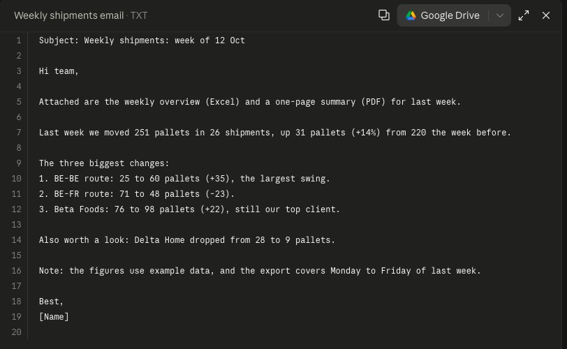
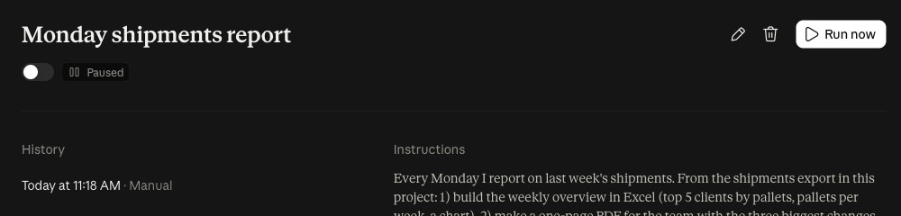
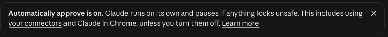

# Starter, step 10: Scheduled tasks

A scheduled task is a Cowork task that runs on its own, at the time you set. You write the task once.

This step puts the [step 9](../09-cowork/) Monday report on a schedule: the same made-up export, the same three
outputs, every Monday at 07:00.

| | |
|---|---|
| Time to set up | about 10 minutes, including one test run |
| You need | a Claude account on Pro, Max, Team or Enterprise. Scheduled tasks are not on Free |
| Tested | claude.ai in a Chromium browser, Team plan, 21 Oct 2026 |
| Download | [shipments-export-sample.csv](shipments-export-sample.csv), [task-instructions.txt](task-instructions.txt), [expected-numbers.md](expected-numbers.md) and [the carousel as a PDF](starter-step10-scheduled-tasks-carousel.pdf) (7 slides) |

## The Scheduled tasks page

On claude.ai, the **Scheduled tasks** page says: "Run tasks on a schedule or whenever you need them." It shows
templates, such as a daily briefing and a weekly review. **New task** has two options: **Create with Claude** and
**Set up manually**.

We did not start there. We started from a project, so the task has the export next to it.

## Where

1. Make a private project. Ours is called **Weekly shipments**.
2. Under **Context**, add [shipments-export-sample.csv](shipments-export-sample.csv). This is the file the task reads.
3. In the same project, next to **Scheduled** ("Set up recurring tasks for this project."), click **+**.

## The task

The **Create scheduled task** form:

- **Name**: Monday shipments report.
- **Instructions**: paste [task-instructions.txt](task-instructions.txt). It is the step 9 prompt, with "From the
  shipments export in this project" instead of "From this export", and one new sentence: "Do not send anything."
- **Model**: we kept the default model.
- **Frequency**: **Weekly**, **07:00**, **Monday**. The other options: **Manual**, **Hourly**, **Daily**,
  **Weekdays** and **Monthly**.
- **Permissions**: **Manually approve** ("Claude pauses so you can approve each action.") or **Automatically
  approve** ("Claude runs without asking."). The default was **Automatically approve**. We kept it, and that is why
  the instructions say "Do not send anything."
- **Advanced settings**: "Notify me when this task finishes", by **Push notification**, **Email** or **Slack**.

"Every Monday I report on last week's shipments. From the shipments export in this project: 1) build the weekly
overview in Excel (top 5 clients by pallets, pallets per week, a chart), 2) make a one-page PDF for the team with the
three biggest changes in the last week compared with the week before, 3) write a short email to the team to send with
it. Do not send anything. Check your numbers against the export before you finish."

After **Save**, the project shows the task as **Active**, "Every Monday at 7:00 AM". The task page shows
"Next run: Oct 26 at 7:00 AM" and a **Run now** button.

## Test it once: Run now

Do not wait for Monday. We pressed **Run now** once. The task history shows it as "Today at 11:18 AM · Manual".

**The result.** When we opened the run a few minutes later, it was finished. It made
`weekly_shipments_overview.xlsx`, `weekly_shipments_summary.pdf` and `weekly_shipments_email.txt`, and sent a phone
notification: "Monday shipments report is ready, nothing sent. ..."

Its numbers: 198 shipments and 1,823 pallets in the export. Last week 251 pallets in 26 shipments, up 31 (+14%) from
220. The three biggest changes: route BE-BE 25 to 60 (+35), route BE-FR 71 to 48 (-23), Beta Foods 76 to 98 (+22).
Also Delta Home, 28 to 9.

We checked these against [expected-numbers.md](expected-numbers.md), counted with a script, not by Claude. All of them
matched. This is one run. Check your own numbers before you send anything.

It also told us three things:

- Last week is incomplete: the export runs to Friday 16 Oct.
- "Biggest changes" was its own call: it mixed routes and clients.
- The email ends with a "[Name]" placeholder for you to fill in.

The run used Sonnet 5.5, the task's default model.

## Pause it

On the task page, the switch next to **Active** pauses the task. The status then shows **Paused**. The task and its
history stay. We paused ours after the test.

## Before you let it run

- **Look at the first runs** before you let it run on its own.
- **Turn off connectors the task does not need.** With **Automatically approve**, claude.ai says: "Claude runs on
  its own and pauses if anything looks unsafe. This includes using your connectors and Claude in Chrome, unless you
  turn them off."
- **Write "Do not send anything." in the instructions.** Read the email, then send it yourself.
- **Replace the export each week.** The export in the project is the file the task reads. Replace it with the new
  week's export before Monday 07:00. We have not tested a run on a replaced file yet.
- Client or patient data your company does not allow in Claude. Test with the sample export first.

Scheduled tasks run remotely, so they run even when your computer is asleep, unless the task needs local files or apps.

## Time win and solution win

- Time win: the step 9 report without starting it yourself: no file to attach, no prompt to paste (our estimate:
  5 minutes a week, on top of step 9).
- Solution win: the same instructions, at the same time, every week. It does not depend on you remembering.

## Sources

- Anthropic help: [Schedule recurring tasks in Cowork](https://support.claude.com/en/articles/13854387-schedule-recurring-tasks-in-cowork),
  read 21 Oct 2026.
- claude.ai itself, 21 Oct 2026: the **Scheduled tasks** page, the **Create scheduled task** form, the task page, and
  the **Automatically approve** banner.

## Next

The Builder steps start: steps 11 to 20.
